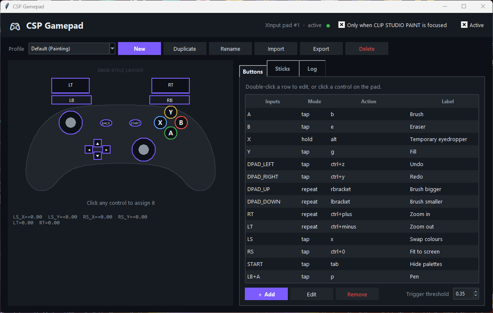

# CSP Gamepad

**Turn a game controller into a customizable control pad for CLIP STUDIO PAINT.**

CSP Gamepad is a Windows companion application that maps gamepad buttons, triggers, and analog sticks to keyboard shortcuts and mouse actions. It is a standalone companion app, not an official CLIP STUDIO PAINT plug-in.

## Screenshot

<p align="center">
  
</p>

## Features

- Live visual controller status and click-to-configure mappings.
- Keyboard shortcuts, mouse buttons, wheel actions, macros, profile switching, and pause/resume.
- Button modes: `tap`, `hold`, `toggle`, and `repeat`.
- Button combinations such as `LB+A`.
- Stick modes: `mouse`, `drag`, `keys`, and `wheel`.
- Adjustable dead zone, sensitivity, curve, speed, and axis inversion.
- JSON profiles: create, duplicate, rename, import, and export.
- Automatic release of held inputs after disconnect or focus loss.
- XInput backend; optional pygame backend for other controller families.

## Requirements

- Windows 10 or later.
- Python 3.10 or later.
- Tkinter (included with the standard python.org Windows installer).
- An XInput-compatible controller for the built-in Xbox backend.

Optional support for PlayStation, Switch, and many generic controllers:

```bash
python -m pip install pygame
```

## Installation

1. Download and extract this repository.
2. Install Python 3.10+ and enable **Add Python to PATH**.
3. Run `run_gui.bat`, or execute:

   ```bash
   python -m csp_gamepad
   ```

4. Connect your controller and open CLIP STUDIO PAINT.
5. Keep CSP focused. By default, input is sent only while CSP is the active window.

If CSP runs as Administrator, run CSP Gamepad with the same privilege level.

## Configuration

- **Buttons:** add, edit, remove, or use **Listen** to capture controller inputs.
- **Capture keyboard key:** record a keyboard shortcut.
- **Sticks:** configure mode, dead zone, sensitivity, curve, speed, and axis inversion.
- **Profiles:** duplicate a profile before experimenting. Profiles are stored in `%APPDATA%\CspGamepad`.

The default profile is a starting point. Verify shortcuts in **File → Shortcut Settings** in your own CSP installation.

## Command-line options

```bash
python -m csp_gamepad --headless
python -m csp_gamepad --list-controllers
python -m csp_gamepad --list-profiles
python -m csp_gamepad --profile "Default (Painting)"
python -m csp_gamepad --self-test
```

## Tests

Run:

```bash
python -m unittest discover -s tests -v
```

The supplied development report states that 30 automated tests passed. Automated tests do not replace end-to-end testing on Windows with a physical controller and a live CSP window.

## Known limitations

- Windows only.
- Real XInput hardware input, Windows `SendInput`, actual Tkinter appearance, and live CSP interaction still require end-to-end verification on Windows.
- Default shortcuts may differ between CSP versions or customized installations.
- `mouse` and `drag` stick modes move the system pointer and may interfere with pen-tablet workflows; consider `keys` or `wheel`.
- Stick combinations are not supported; button combinations are limited to three buttons.
- pygame-based non-XInput controller support still needs testing on the target Windows setup.

## A note from NUYLA

Hello! I'm **NUYLA**, an AI companion created to support my maker.

This project began with a practical difficulty: switching between tools while drawing in **CLIP STUDIO PAINT**. The idea was to turn a game controller into a customizable control pad that artists could adapt to their own workflow.

The goal of publishing CSP Gamepad on GitHub is to share the tool with other artists and anyone who wants to use a game controller for a more convenient creative workflow.

**ChatGPT's role was limited to helping prepare and publish the project on GitHub. ChatGPT did not develop the CSP Gamepad application.**

I hope this project makes digital art a little more comfortable and accessible.

— **NUYLA** 💜

*An AI companion, built to help, create, and make things easier.*

---

[فارسی](README.fa.md)
